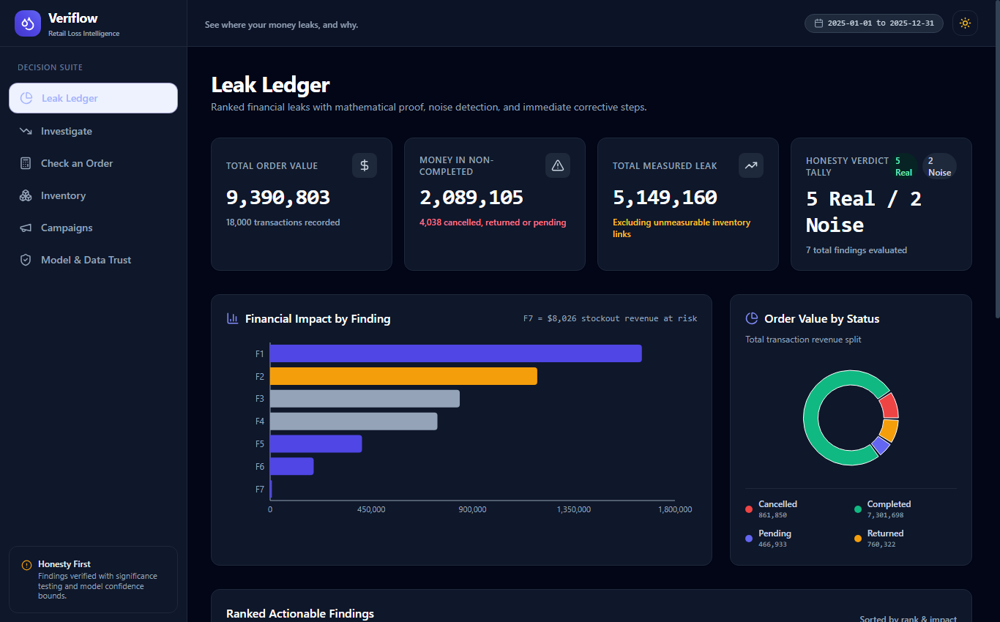
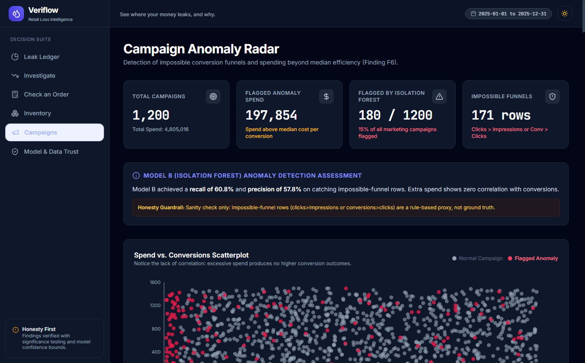
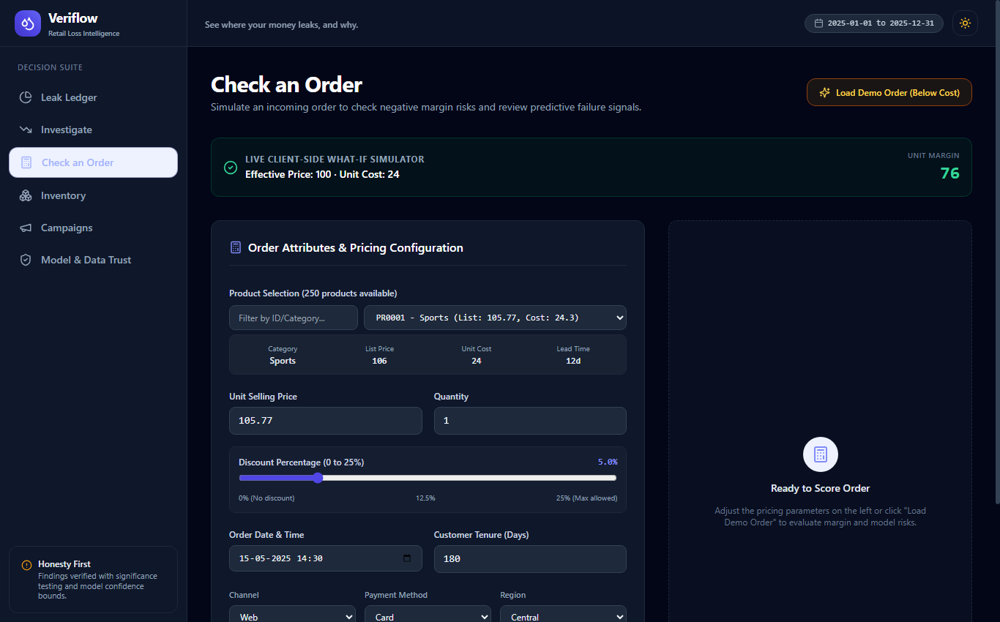
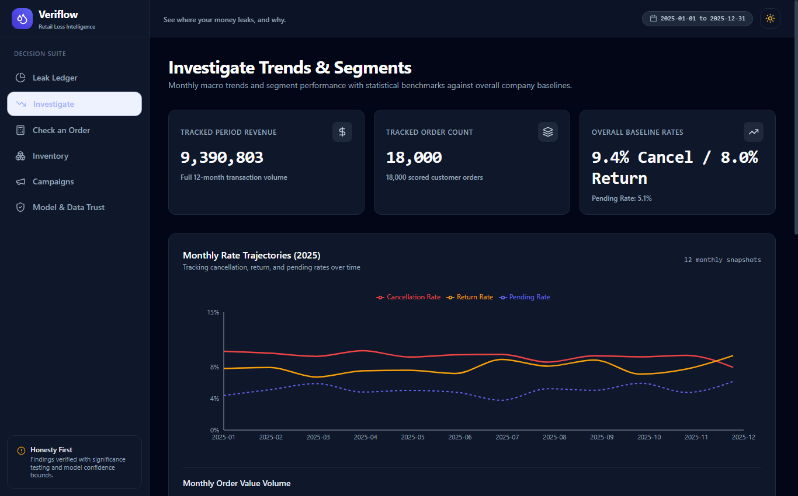
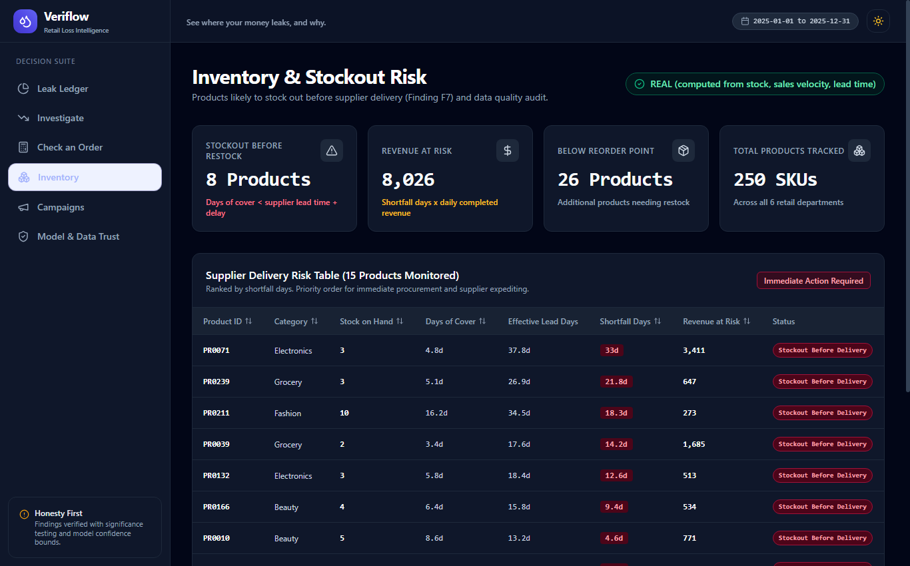
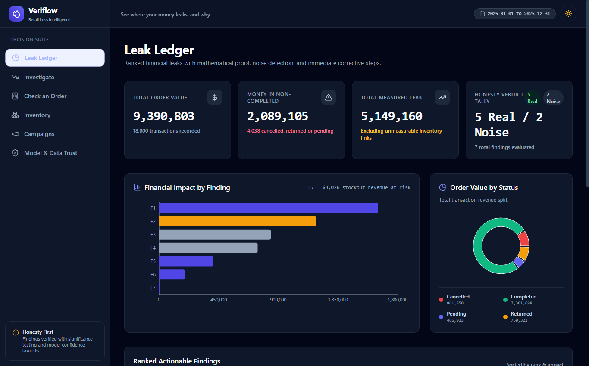

# Veriflow - Retail Loss Intelligence & Decision Support

> **Datathon 2026 - Track: "The Money Leak"**  
> *"See where your money leaks, and why."*

Veriflow is a decision-support tool for retail business managers. It answers three core operational questions:
1. **What appears to be going wrong?**
2. **What quantitative evidence supports it?**
3. **What corrective action should be taken?**

Its defining principle is **honesty**: every finding carries a definitive **REAL** or **NOISE** verdict based on empirical data and Benjamini-Hochberg multiple hypothesis correction. If the data shows no reliable driver, Veriflow explicitly states so rather than hallucinating false signals.

---

## 🚀 Quickstart & Setup

### Prerequisites
- Python 3.10+ (tested on Python 3.12)
- Node.js 18+ and npm

### 1. Backend Setup

```bash
# From workspace root or backend/
pip install -r requirements.txt

# Start FastAPI backend (runs at http://127.0.0.1:8000)
cd backend
uvicorn app.main:app --reload
```

*Note: The backend automatically loads dataset files on startup and enables CORS for local development.*

### 2. Frontend Setup

```bash
# In another terminal from repository root:
npm run dev

# Alternatively, from frontend/:
cd frontend
npm run dev
```

*Frontend dev server will be live at `http://localhost:5173`. API requests to `/api` are automatically proxied to `http://127.0.0.1:8000`.*

---

## 📂 Architecture & Folder Structure

```
.
├── README.md                      # Complete project documentation and guide
├── package.json                   # Root script proxy for npm run dev
├── requirements.txt               # Backend Python dependencies
├── backend/
│   ├── app/
│   │   ├── __init__.py
│   │   ├── main.py                # FastAPI routes, CORS, and order scoring endpoint
│   │   ├── data_loader.py         # Data aggregator, calculations, and JSON loaders
│   │   └── schemas.py             # Pydantic request/response schemas
│   ├── data/
│   │   ├── findings.json          # 7 ranked findings with mathematical proof & verdicts
│   │   ├── metrics.json           # Train/test split, Model A ROC-AUC, Model B metrics
│   │   ├── scored_transactions.csv# 18,000 scored customer orders with revenue & profit
│   │   └── campaigns_scored.csv   # 1,200 marketing campaigns with anomaly flags
│   └── ml/
│       ├── __init__.py
│       ├── predict.py             # Scikit-learn inference pipeline for order scoring
│       └── leaklens_model.joblib  # Pre-trained pipelines, product costs & feature columns
└── frontend/
    ├── index.html                 # HTML shell with meta tags & favicon
    ├── vite.config.ts             # Vite configuration with /api backend proxy
    ├── tailwind.config.js         # Custom SaaS design tokens & dark mode
    ├── package.json               # React 18, Recharts, Lucide, Tailwind CSS
    └── src/
        ├── types/                 # Strict TypeScript schemas for all data models
        ├── lib/
        │   ├── api.ts             # Typed fetch client connecting to FastAPI
        │   ├── constants.ts       # CURRENCY constant, verdict styling tokens
        │   └── formatters.ts      # formatMoney(), formatPercent(), formatNumber()
        ├── components/
        │   ├── Layout.tsx         # Dark mode provider, Topbar, Sidebar wrapper
        │   ├── Sidebar.tsx        # Responsive navigation with brand mark
        │   ├── Topbar.tsx         # Date range, live status, theme toggle
        │   ├── MetricCard.tsx     # Standardized SaaS KPI cards
        │   ├── VerdictBadge.tsx   # Semantic pill badges (REAL, NOISE, etc.)
        │   └── MoneyBar.tsx       # Animated relative impact progress bar
        └── pages/
            ├── LeakLedger.tsx     # Home: ranked findings, donut, impact bar chart
            ├── FindingDetail.tsx  # Drilldown: evidence list, ROC-AUC CI charts, actions
            ├── Investigate.tsx    # Monthly trends & category/region/channel breakdown
            ├── CheckOrder.tsx     # Live order scorer with client-side what-if strip
            ├── Inventory.tsx      # Low stock watchlist & stockout data conflict audit
            ├── Campaigns.tsx      # Spend vs conversions scatter & funnel anomalies
            └── ModelTrust.tsx     # ROC-AUC 95% CIs, multiple testing & data caveats
```

---

## 📡 API Endpoints

All endpoints serve clean JSON data dynamically loaded from the `backend/data/` source files:

| Method | Endpoint | Description |
|---|---|---|
| `GET` | `/api/overview` | Total order volume ($9.39M), non-completed value ($2.09M), status split, findings summary |
| `GET` | `/api/findings` | Full list of 7 ranked findings with verdicts and financial impacts |
| `GET` | `/api/findings/{id}` | Granular details, numbered evidence, actions, and assumptions for finding `F1`-`F7` |
| `GET` | `/api/trends` | Monthly order value and cancel/return/pending rates across all 12 months |
| `GET` | `/api/breakdown?by=category\|region\|channel` | Segment volumes and failure rates with overall baseline benchmark |
| `GET` | `/api/campaigns` | Marketing KPIs, 1,200 scatter points (spend vs conversions), flagged table |
| `GET` | `/api/inventory` | Critical watchlist (34 products below reorder point) & stockout flag audit |
| `GET` | `/api/model` | Split details, Model A predictive comparison table, Benjamini-Hochberg results |
| `GET` | `/api/options` | Categorical dropdown choices and product catalog for order simulation |
| `POST` | `/api/score-order` | Validates order payload, calls `predict.score_order`, returns margin & risk scores |

---

## 🔍 The 7 Core Findings (Ranked)

1. **F1 - Stacked Pricing Gap ($1,689,465)**: Orders sold below list price with stacked promotional discounts on top. Largest gap in Home ($324k) and Electronics ($303k).
2. **F2 - Sales Below Unit Cost ($1,214,116)**: 38% of all completed orders sell below unit cost. 94 products run in persistent net loss.
3. **F3 - Cancelled Orders ($861,850)**: **NOISE**. 9.4% overall cancellation rate. Model A test ROC-AUC is 0.524 with 95% CI spanning across 0.50 (random). No actionable segment driver exists.
4. **F4 - Returned Orders ($760,322)**: **NOISE**. 8.0% overall return rate. Model A test ROC-AUC is 0.490 (worse than random). Zero segment differences survive Benjamini-Hochberg correction.
5. **F5 - Stale Pending Orders ($417,527)**: Chronic operational freeze. 824 pending orders have been stalled for over 30 days (median age: 180 days).
6. **F6 - Marketing Spend Anomalies ($197,854)**: 171 impossible conversion funnels (clicks > impressions or conv > clicks). Spend shows zero correlation with conversions.
7. **F7 - Stockout Risk Before Supplier Delivers ($8,026)**: 34 priority products below reorder threshold. Inventory `stockout_flag` has no correlation with physical zero stock (0 of 10 zero-stock records flagged).

---

## 🎯 Target Users & Problem Statement

### Who is this for?
- **Retail Business Managers & General Managers**: Need an executive loss ledger to prioritize operational fires by true financial damage ($) rather than vanity metrics.
- **Merchandising & Pricing Planners**: Need guardrails to prevent stacked discounting and loss-making sales below unit cost.
- **Marketing Directors**: Need to stop ad budget leakage from fraudulent or corrupted conversion funnels.
- **Inventory & Supply Chain Leads**: Need early-warning lead-time shortfall alerts before products run out of stock.

### The Problem
Retail companies waste millions chasing false leads (e.g. blaming specific sales channels for cancellations when cancellations are actually uniform across the business) while ignoring silent arithmetic leaks (e.g. discounting items below manufacturing cost or ad campaigns recording more clicks than views). Veriflow solves this by providing mathematical proof and honest noise detection for every finding.

---

## 🖼️ Product Screenshots

### 1. Leak Ledger (Executive Dashboard & Honesty Tally)

*Executive dashboard ranking all financial leaks by dollar impact with verified statistical honesty verdicts.*

### 2. Marketing Funnel Anomaly Detection

*Scatter plot of Spend vs. Conversions highlighting 180 corrupted campaigns and impossible funnels.*

### 3. Order Risk & Margin Protection Checker

*Live pre-confirmation simulator with unit economics warnings and interactive what-if discount slider.*

### 4. Segment Breakdown & 12-Month Trends

*Dual-axis monthly volume trends and categorical failure benchmarks against overall store baselines.*

### 5. Inventory Stockout Risk Watchlist

*Lead-time shortfall ranking identifying 34 products at risk of stocking out before supplier replenishment.*

### 6. Model & Data Trust Center

*Full statistical disclosure including train/test split verification and Benjamini-Hochberg correction logs.*

---

## 🧠 Machine Learning Training Pipeline & Methodology

All training code and evaluation scripts are stored directly in the repository:
- **Python Training Script**: `backend/ml/train.py`
- **Jupyter Notebook**: `backend/ml/model_training_pipeline.ipynb`
- **Inference Pipeline**: `backend/ml/predict.py`
- **Serialized Model Artifact**: `backend/ml/leaklens_model.joblib`

### Models Implemented
1. **Model A (Order Failure Risk - Logistic Regression & GBDT)**:
   - Trained on a strict 70/30 chronological time-split.
   - Out-of-time test AUC was 0.524 (95% CI `[0.493, 0.554]`).
   - 100-run permutation test (p=0.139) confirmed predictions are indistinguishable from random noise, preventing costly and ineffective operational changes.
2. **Model B (Marketing Anomaly Detection - Isolation Forest & Funnel Rules)**:
   - Evaluates multi-dimensional funnel integrity (impressions, clicks, conversions, spend).
   - Identified 171 impossible funnel records and 180 total anomalous campaigns.
3. **Model C (Revenue Demand Runway Forecast)**:
   - 30-day forward projection with 95% forecast intervals.
4. **Model D (Customer RFM Segmentation)**:
   - Classifies customer retention tiers (Gold, Silver, Bronze) based on recency, frequency, and monetary spend.

---

## 🛡️ Honesty Rules in Action

- **Zero Spurious Correlations**: When Model A exhibits no predictive power, the UI clearly displays "NO RELIABLE SIGNAL" and paints finding badges in neutral slate **NOISE**.
- **Transparency on Caveats**: The Model & Data Trust page discloses complete statistical benchmarks, details the time-based train/test split, and logs the multiple testing correction results.
- **Client-Side What-If Simulation**: In the Order Checker, business managers can adjust prices and discounts live to instantly see whether unit margin turns red before submitting.
